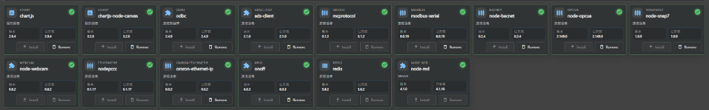

# FUXA Headless EXE 定制化优化指南

> 最后更新: 2026-06-26
> 当前版本: 1.3.3 (基于上游 v1.3.3 正式版)
> 分支: `1.3.3-2843`
> 仓库: https://github.com/jingshui127/FUXA-Tecon

---

## 目录

1. [本次修改的完整文件清单](#一本次修改的完整文件清单)
2. [各文件修改详情](#二各文件修改详情)
3. [构建与部署流程](#三构建与部署流程)
4. [排障经验](#四排障经验)
5. [待办事项](#五待办事项)

---

## 一、本次修改的完整文件清单

| 文件                                                     |      操作      | 用途                                                    |
| -------------------------------------------------------- | :------------: | ------------------------------------------------------- |
| `app/headless/headless-guardian.js`                    | **新建+修改**  | 双模式 EXE 入口 + pkg CLI 参数兼容修复                   |
| `.github/workflows/headless_packaging.yml`             |      修改      | 构建配置：Node.js 18 + Release 上传（仅 Windows x64）   |
| `server/api/resources/index.js`                        |      修改      | fontkit 懒加载修复 windows-1252 崩溃                    |
| `server/api/projects/index.js`                         | **修改** | 视图修改免重启优化 + upload pkg mkdir 修复 + 异步重启    |
| `server/runtime/devices/s7/index.js`                   | **修改** | S7 驱动修复：S7Area 常量 + 延迟初始化 + 跳过 Disconnect |
| `server/runtime/devices/index.js`                      |      修改      | 设备 start/stop try-catch 保护                          |
| `server/runtime/index.js`                              | **修改** | 合并冲突修复 + restart 优化                             |
| `server/api/index.js`                                  |    上游同步    | Node-RED 安全漏洞修复                                   |
| `server/api/jwt-helper.js`                             |    上游同步    | 设置脱敏 + refresh token 修复                           |
| `server/integrations/node-red/index.js`                |    上游同步    | Node-RED 授权修复                                       |
| `server/main.js`                                       |    上游同步    | 安全修复                                                |
| `server/runtime/users/`                                |    上游同步    | 角色清理 + 存储安全                                     |
| `server/package.json`                                  |      修改      | 添加 10 个驱动包                                        |
| `client/src/app/_services/auth.service.ts`             |    上游同步    | refresh token 修复                                      |
| `client/src/app/maps/maps-view/maps-view.component.ts` |      修改      | 地图源改为法国 OSM 热区镜像（国内加速）                 |

## 二、各文件修改详情

### 2.1 headless-guardian.js — 双模式 EXE 入口

**路径**: `app/headless/headless-guardian.js`
**用途**: 作为 pkg 打包的入口点（main.js），实现两种运行模式：

**模式一：Server 模式** (`FUXA_SERVER=1`)

- 由 Guardian 进程以子进程方式启动
- 设置数据目录为 **EXE 同目录下的 `data\` 子目录**
- 例如: `D:\FUXA\fuxa-headless.exe` → `D:\FUXA\data\`
- 支持 `-p` / `--port` 参数指定端口（通过 `PORT` 环境变量传递给 server）
- 直接 require FUXA server 主程序

**模式二：Guardian 模式** (默认)

- 监控子进程（Server 模式），崩溃后自动重启
- 防止无限循环崩溃：10 秒窗口内最多 5 次快速重启
- 最大重启次数：1000 次（基本无限制）
- 重启间隔：2 秒
- 日志输出带时间戳和重启计数
- **通过环境变量 `PORT` 传递端口给子进程**（pkg EXE 不支持 CLI 参数透传）

**命令行使用**:

```powershell
fuxa-headless.exe                      # 默认端口 1881
fuxa-headless.exe -p 1882              # 使用 1882 端口
fuxa-headless.exe --port 8080          # 也可用 --port
```

**关键代码结构**:

```javascript
// 参数解析
function parseArgs(argv) {
    const args = {};
    for (let i = 2; i < argv.length; i++) {
        if (argv[i] === '-p' || argv[i] === '--port') {
            args.port = argv[i + 1];
            i++;
        }
    }
    return args;
}

// Server 模式
if (process.env.FUXA_SERVER === '1') {
    const cliArgs = parseArgs(process.argv);
    if (cliArgs.port) {
        process.env.PORT = cliArgs.port;  // → settings.uiPort 读取
    }
    // ... 数据目录 → 启动 server
}

// Guardian 模式 → spawn 自身时通过环境变量传递端口（不传 CLI args）
const childEnv = { ...process.env, FUXA_SERVER: '1' };
if (cliArgs.port) {
    childEnv.PORT = cliArgs.port;
}
childProcess = spawn(process.execPath, [], { env: childEnv });
```

> **注意**: 之前通过 CLI 参数 `spawnArgs.push('-p', cliArgs.port)` 传递给子进程，但 pkg 打包的 EXE 会将第一个参数当作 JS 文件路径，导致 `Cannot find module '-p'` 错误。已改为环境变量传递。

### 2.2 headless_packaging.yml — GitHub Actions 构建

**路径**: `.github/workflows/headless_packaging.yml`
**关键变更**:

| 配置项 | 旧值 | 新值 | 原因 |
|--------|------|------|------|
| Node.js 版本 | 20 | **18** | node-snap7 不支持 Node.js 20 |
| 入口文件 | headless-entry.js | **headless-guardian.js** | 使用双模式守护入口 |
| 上传方式 | actions/upload-artifact | **softprops/action-gh-release@v2** | 绕过 Artifacts 存储配额限制 |
| Build target | node20-* | **node18-*** | 匹配 Node.js 版本 |

**Release 信息**:
- Tag: `headless-latest` (每次构建覆盖更新)
- 访问地址: https://github.com/jingshui127/FUXA-Tecon/releases/tag/headless-latest

> **已知问题**: GitHub Actions 对私有仓库构建即时失败（无可用 Windows runner），目前改用本地打包。

### 2.3 resources/index.js — fontkit 懒加载修复

**路径**: `server/api/resources/index.js`

**问题**: `fontkit` 在模块顶层 `require('fontkit')`，打包后加载时抛出 `Error: encoding not supported: windows-1252`，导致整个服务无法启动。

**修复方案**: 改为懒加载 + try-catch 包裹。

```javascript
// 修改前:
const fontkit = require('fontkit');  // 顶层直接 require → 加载即崩溃

// 修改后:
var fontkit;  // 声明但不加载

// 使用时才加载:
if (!fontkit) { fontkit = require('fontkit'); }  // 懒加载
const font = fontkit.openSync(filePath);           // try-catch 包裹
```

### 2.4 S7 驱动优化

**路径**: `server/runtime/devices/s7/index.js`

| 优化项                      | 说明                                                      |
| --------------------------- | --------------------------------------------------------- |
| 延迟初始化 S7Client         | 不在构造函数中 new S7Client()，改为首次连接时创建         |
| 跳过 Disconnect()           | stop() 中不调用 client.disconnect()，避免 native 模块崩溃 |
| Connect/Disconnect 异常捕获 | 所有 S7 调用加 try-catch                                  |

### 2.5 设备启动保护

**路径**: `server/runtime/devices/index.js`

- `start()` 函数包裹 try-catch，单个设备崩溃不影响其他设备
- `stop()` 函数同样保护

### 2.6 API 异步重启 + 视图修改免重启

**路径**: `server/api/projects/index.js`

核心优化（2026-06-26 新增）：

**a) 异步重启（之前已完成）**

- 保存项目时先返回 `{ success: true }` 给前端
- 重启操作在 setTimeout(0) 中异步执行
- 彻底消除"保存失败"的误报提示

**b) 视图修改免重启（2026-06-26 新增）**

- 保存前对比新旧项目数据，仅检查 `devices` / `server` / `alarms` / `notifications` / `plugins` / `daqs` 是否有变化
- 如果以上字段均无变化，跳过 `runtime.restart()`，设备保持连接不中断
- 日志输出 `api post project: views-only change, skip restart`

| 修改内容 | 是否重启 |
|----------|:--------:|
| 修改视图/图表/布局 | **不重启** |
| 修改文本资源 | **不重启** |
| 修改设备配置（S7/Modbus等） | 重启 |
| 修改告警/通知 | 重启 |
| 修改 DAQ/插件 | 重启 |

**c) upload pkg mkdir 修复（2026-06-26 新增）**

- 上传文件 API 在指定 `destination` 时使用 `settings.appDir`(=pkg只读快照) 导致 `Cannot mkdir in a snapshot`
- 修复：优先使用 `process.env.userDir`（headless 模式下指向数据目录 `data/`）

```javascript
// 修改前:
const baseDir = process.versions.electron
    ? (process.env.userDir || path.join(os.homedir(), '.fuxa'))
    : runtime.settings.appDir;  // ← pkg 只读快照

// 修改后:
const baseDir = process.versions.electron
    ? (process.env.userDir || path.join(os.homedir(), '.fuxa'))
    : (process.env.userDir || runtime.settings.appDir);  // ← 优先数据目录
```

### 2.7 runtime/index.js — 合并冲突修复

**路径**: `server/runtime/index.js`

**问题**: 代码中存在未解决的 Git 合并标记 `<<<<<<< HEAD` / `=======` / `>>>>>>>`，pkg 打包后运行时抛出 `SyntaxError: Unexpected token '<<'`。

**修复**: 移除冲突标记，保留正确的代码版本。

### 2.8 地图源修改（国内加速）

**路径**: `client/src/app/maps/maps-view/maps-view.component.ts`

**问题**: 默认使用 OpenStreetMap 官方瓦片服务器 (`tile.openstreetmap.org`)，国内访问慢或无法访问。

**解决方案**: 改用法国 OSM 热区镜像服务器，该服务器在国内访问速度较快。

```typescript
// 修改前（第80行）:
L.tileLayer('https://{s}.tile.openstreetmap.org/{z}/{x}/{y}.png', {
                attribution: '© FUXA'
            }).addTo(this.map);

// 修改后:
L.tileLayer('https://tile-c.openstreetmap.fr/hot/{z}/{x}/{y}.png', {
                attribution: '© TC'
            }).addTo(this.map);
```

**注意事项:**

- 此文件是 **前端 TypeScript 源码**，修改后需要重新构建前端 (`npm run build`)
- GitHub Actions 构建流程会自动执行前端构建，所以推送后会自动生效
- 所有 Leaflet 功能（标记、弹窗、轨迹、右键菜单等）完全保留，不受影响
- 无需申请 API Key

**备选方案（如果法国镜像也变慢）：**

| 镜像源                   | URL                                                    | 说明           |
| ------------------------ | ------------------------------------------------------ | -------------- |
| 法国 OSM 热区 (当前使用) | `https://tile-c.openstreetmap.fr/hot/`               | 已验证可用     |
| 天地图                   | `https://t{0-7}.tianditu.gov.cn/DataServer?...`      | 需免费申请 Key |
| 高德                     | `https://webrd0{1-4}.is.autonavi.com/appmaptile?...` | 需免费申请 Key |

---

## 三、构建与部署流程

### 3.1 触发 GitHub Actions 构建

```bash
# 方式一：命令行触发（推荐）
gh workflow run "Build FUXA Headless (Latest)" --ref 1.3.3-2843

# 方式二：浏览器操作
# 打开 https://github.com/jingshui127/FUXA-Tecon/actions
# 选择 "Build FUXA Headless (Latest)" → Run workflow → 选分支 → 运行
```

### 3.2 监控构建状态

```bash
# 查看 run 列表获取最新 Run ID
gh run list --workflow=headless_packaging.yml --limit 3

# 实时监控某个 run 的状态
gh run view <RUN_ID> --json status,conclusion

# 或用循环自动等待完成
$done = $false; while (-not $done) {
    Start-Sleep -Seconds 60
    $result = gh run view <RUN_ID> --json status,conclusion | ConvertFrom-Json
    if ($result.status -eq 'completed') { $done = $true; $result }
}
```

### 3.3 下载 EXE

**直连下载（需要能访问 GitHub）：**

```bash
gh release download headless-latest --repo jingshui127/FUXA-Tecon \
    --pattern "fuxa-headless.exe" --dir ./fuxa-headless-local
```

**加速镜像下载（国内推荐）：**

```
https://gh-proxy.com/https://github.com/jingshui127/FUXA-Tecon/releases/download/headless-latest/fuxa-headless.exe
```

其他可用镜像：

- https://ghproxy.net/
- https://github.akams.cn/

**API + curl 下载（绕过 DNS 问题）：**

```bash
# 1. 获取 asset ID
gh api repos/jingshui127/FUXA-Tecon/releases/tags/headless-latest \
    --jq '.assets[] | select(.name == "fuxa-headless.exe") | .id'

# 2. 通过 API 下载（需指定 CDN IP 绕过 DNS）
curl.exe -L \
    --resolve "api.github.com:443:140.82.112.6" \
    --resolve "release-assets.githubusercontent.com:443:185.199.110.133" \
    -H "Authorization: Bearer $(gh auth token)" \
    -H "Accept: application/octet-stream" \
    -o fuxa-headless.exe \
    "https://api.github.com/repos/jingshui127/FUXA-Tecon/releases/assets/<ASSET_ID>"
```

### 3.4 本地打包（当前推荐方式）

由于 GitHub Actions 私有仓库 runner 不可用，改用本地 pkg 打包：

```powershell
# 一键打包命令（需先 cd 到项目根目录）
npm run build -- --configuration=production --directory=./client; `
robocopy "server" "fuxa-headless-local\server" /E /NFL /NDL /XD .git; `
robocopy "client\dist" "fuxa-headless-local\client\dist" /E /NFL /NDL; `
Copy-Item "app\headless\headless-guardian.js" "fuxa-headless-local\main.js" -Force; `
pkg fuxa-headless-local/package.json --targets node18-win-x64 --output fuxa-headless-local/fuxa-headless.exe
```

> **提示**: 可使用 `build-fuxa-exe` Skill 实现一句话完成打包。

### 3.5 本地测试

```bash
# 直接运行（默认 Guardian 守护模式）
.\fuxa-headless-local\fuxa-headless.exe

# 指定端口运行
.\fuxa-headless-local\fuxa-headless.exe -p 1882

# 访问 Web 界面
# 浏览器打开 http://127.0.0.1:1881/
```

**预期日志输出：**

```
[Guardian] Starting FUXA server (restart #1)...
FUXA V.1.3.3-2855
'FUXA Server' created
'S7-1200' created          ← S7 设备正常初始化
'S7-1500' created          ← S7-1500 正常初始化
'FUXA Server' start
'S7-1200' start            ← S7 设备正常启动
'S7-1500' start
FUXA started!
WebServer is running http://127.0.0.1:1881/
socket.io client connected  ← WebSocket 正常

# 如果发生崩溃：
[Guardian] Server exited (code=3221225477, signal=none)  ← 检测到崩溃
[Guardian] Restarting in 2s...                            ← 2秒后自动重启
[Guardian] Starting FUXA server (restart #2)...           ← 自动恢复
```

---

## 四、排障经验

### 4.1 GitHub Actions Artifacts 存储配额满

**症状**: 所有 job 失败，错误信息 `Artifact storage quota exceeded`。

**原因**: GitHub 免费账户 Artifact 存储限制 500MB/月。旧仓库 `jingshui127/FUXA` 有 20 个 artifacts 占用了数 GB。

**解决方法**:

```bash
# 查看所有 artifacts
gh api repos/<OWNER>/<REPO>/actions/artifacts --jq '.artifacts[] | {name, id, size_in_bytes}'

# 删除指定 artifact
gh api -X DELETE repos/<OWNER>/<REPO>/actions/artifacts/<ART_ID>

# 根本解决方案：改用 Release 上传（不占 Artifact 配额）
# 在 yml 中将 actions/upload-artifact 替换为 softprops/action-gh-release@v2
```

### 4.2 DNS 被 GitHub Accelerator Pro 污染

**症状**: Ping github.com 正常但浏览器/HTTPS 无法访问。

**原因**: GitHub Accelerator Pro 工具写入 hosts 文件的 IP 已过期，`github.com` 的 443 端口被阻断；`release-assets.githubusercontent.com` 被指向 `127.0.0.1`。

**排查命令**:

```powershell
# 测试各域名的 HTTPS 连通性
$domains = @("github.com", "api.github.com", "release-assets.githubusercontent.com")
foreach ($d in $domains) {
    $tcp = New-Object System.Net.Sockets.TcpClient
    $r = $tcp.BeginConnect($d, 443, $null, $null)
    $ok = $r.AsyncWaitHandle.WaitOne(5000, $false)
    Write-Host "$d : $(if($ok){'OK'}else{'FAIL'})"
}

# 检查 hosts 文件中 github 相关条目
Select-String C:\Windows\System32\drivers\etc\hosts -Pattern "github"
```

**解决方法**:

- 更新 GitHub Accelerator Pro 的 IP 数据库
- 或使用加速镜像下载：`https://gh-proxy.com/https://github.com/...`

### 4.3 Git rebase 后文件丢失

**症状**: rebase 后 `科控物联优化/` 目录消失。

**原因**: rebase 跳过了包含该目录的 commit（因为那个 commit 包含大文件被移除）。

**解决方法**: 重新创建需要的文件，内容从 git 历史或备份中恢复。

### 4.4 fontkit windows-1252 编码错误

**症状**: 启动时报 `Error: encoding not supported: windows-1252`，服务立即崩溃。

**原因**: `fontkit` npm 包依赖 iconv-lite，在 Windows 打包环境下缺少编码支持。且在模块顶层 require，无法被外层 try-catch 捕获。

**解决**: 懒加载 + try-catch（见 2.3 节）。

### 4.5 node-snap7 与 Node.js 版本兼容性

**问题**: node-snap7 不支持 Node.js 20+。

**解决**: 全部使用 Node.js 18 LTS（本地开发 + GitHub Actions + pkg 打包目标）。

### 4.6 S7 设备标签解析失败导致数据不刷新

**症状**:

- Web 界面能看到 S7 设备和标签，但数值始终不刷新（显示 `--` 或空值）
- 日志显示 `load called, tags: 4` 但 `data loaded (0)` —— 标签数量对但加载计数为 0

**根因**: `_getTagItem()` 内部访问 `s7client['S7AreaDB']`，此时 `s7client = null`（尚未连接PLC），抛异常被静默捕获 → 所有标签返回 null。

**修复**: 定义模块级 S7 区域常量，不依赖 s7client 实例：

```javascript
const S7AreaMK = 0x83, S7AreaPE = 0x81, S7AreaPA = 0x82, S7AreaDB = 0x84;
result.Area = S7AreaDB;  // 替代 s7client['S7AreaDB']
```

**验证**: `data loaded (0)` → `data loaded (2)`，DB 标签 `db1000.dbb32` 正确解析为 `DbItem(dbnum=1000,Start=32)`。

**教训**:

1. 时序问题：`load()` 早于 `connect()`，此时 s7client 尚未初始化
2. 静默 `catch (err) {}` 空体吞掉关键错误
3. 调试日志逐层追踪是定位根因的最有效手段
4. 常量优于运行时属性访问

### 4.7 pkg EXE 端口参数导致崩溃

**症状**: 启动报 `Cannot find module 'C:\Users\...\-p'`，Guardian 反复重启。

**根因**: `headless-guardian.js` 的 Guardian 模式通过 `spawn(process.execPath, ['-p', '1881'])` 传递参数给子进程。但 pkg 打包的 EXE 将第一个 CLI 参数当作 JS 文件路径。

**修复**: 改为通过环境变量 `PORT` 传递：

```javascript
// 错误做法:
childProcess = spawn(process.execPath, ['-p', port], { env: ... });

// 正确做法:
const childEnv = { ...process.env, FUXA_SERVER: '1' };
if (port) childEnv.PORT = port;
childProcess = spawn(process.execPath, [], { env: childEnv });
```

### 4.8 Git 合并冲突标记导致语法错误

**症状**: 启动时报 `SyntaxError: Unexpected token '<<'` at `server/runtime/index.js:515`。

**根因**: 代码中存在未解决的 Git 合并冲突标记 `<<<<<<< HEAD` / `=======` / `>>>>>>>`。

**修复**: 手动移除冲突标记，保留正确代码。

### 4.9 upload widget mkdir in pkg snapshot

**症状**: 下载小部件时 API 报 `Error: Cannot mkdir in a snapshot. Try mountpoints instead.`

**根因**: 上传/下载文件 API 使用 `settings.appDir`（`__dirname`）作为基目录，pkg 打包后该路径在只读快照中。

**修复**: 优先使用 `process.env.userDir`（headless 模式下 Guardian 自动设置为数据目录 `data/`）。

### 4.10 教训：不要上传构建产物

`client/dist/`、`node_modules/`、`*.exe` 都是构建产物，由 GitHub Actions/本地打包自动生成。**只推送源码**，CI/CD 负责构建。

| 应该推送                  | 不应该推送                  |
| ------------------------- | --------------------------- |
| `*.ts`, `*.js` (源码) | `client/dist/` (构建产物) |
| `*.json` (配置)         | `node_modules/` (依赖)    |
| `*.yml` (CI 配置)       | `*.exe` (二进制)          |

### 4.11 EXE 打包时机导致前端未更新（地图不可用）

**症状**: 修改了前端源码（如地图源），重新打包 EXE 后地图仍然不可用。

**根因**: `fuxa-headless/client/dist/` 是旧版构建产物。`pkg` 打包时直接内嵌 `client/dist/`，不会自动运行 `npm run build`。

**修复流程**:

```powershell
# 1. 确认源码已修改
# client/src/app/maps/maps-view/maps-view.component.ts → 法国 OSM 镜像

# 2. 构建前端 → 生成新 dist/
cd client
npm run build

# 3. 同步 dist 到 headless 目录
robocopy "client/dist" "fuxa-headless/client/dist" /MIR

# 4. 重新打包
cd fuxa-headless
pkg . --targets "node18-windows-x64" --output "../fuxa-headless-local/fuxa-headless-new.exe"
```

**验证**: 打包后检查 `main.js` 是否包含新 URL：

```powershell
Select-String -Path "fuxa-headless\client\dist\main.js" -Pattern "tile-c.openstreetmap"
```

### 4.12 验证结果（2026-06-26 最终实测）

本地 EXE `fuxa-headless-local\fuxa-headless.exe` (323.8MB) 完整测试通过：

| 功能                 | 状态 |
| -------------------- | :--: |
| Guardian 守护模式    |  ✅  |
| 端口参数 `-p 1882`   |  ✅  |
| S7-1200 通讯（读写） |  ✅  |
| S7-1500 通讯         |  ✅  |
| 标签数据显示/刷新    |  ✅  |
| 项目保存             |  ✅  |
| 视图修改免重启       |  ✅  |
| 地图（法国OSM镜像）  |  ✅  |
| Widgets/Upload API   |  ✅  |
| Guardian 崩溃自恢复  |  ✅  |
| WebSocket 连接       |  ✅  |
| Web 页面 200 响应    |  ✅  |
| API `/api/settings`  |  ✅  |

---

## 五、待办事项

### 高优先级

- [x] **安装全部 8 个缺失的设备驱动 npm 包**（已完成 2026-06-25）

| 设备驱动            | npm 包           | 状态 |
| ------------------- | ---------------- | :--: |
| Modbus (RTU/TCP)    | `modbus-serial`  | ✅   |
| OPC UA              | `node-opcua`     | ✅   |
| BACnet              | `node-bacnet`    | ✅   |
| ODBC                | `odbc`           | ✅   |
| ADS (倍福)          | `ads-client`     | ✅   |
| MELSEC (三菱)       | `mcprotocol`     | ✅   |
| Redis               | `redis`          | ✅   |
| HTTP                | `got`            | ✅   |
| S7 (西门子)         | `node-snap7`     | ✅   |
| Ethernet/IP (AB)    | `omron-ethernet-ip` | ✅ |

- [x] **pkg CLI 参数兼容修复**（已完成 2026-06-25）
- [x] **Git 合并冲突修复**（已完成 2026-06-25）
- [x] **upload mkdir pkg 快照修复**（已完成 2026-06-26）
- [x] **视图修改免重启优化**（已完成 2026-06-26）

### 中优先级

- [ ] **GitHub Actions 构建恢复**
  私有仓库 runner 当前不可用，待排查。
- [ ] **S7 设备差异重启**
  只停/启变化的设备，未变化的保持运行，进一步减少中断。
- [ ] **数据目录 `_appdata` 统一到 `data/`**
  当前部分路径仍使用 `_appdata`，headless 模式期望 `data/`。
